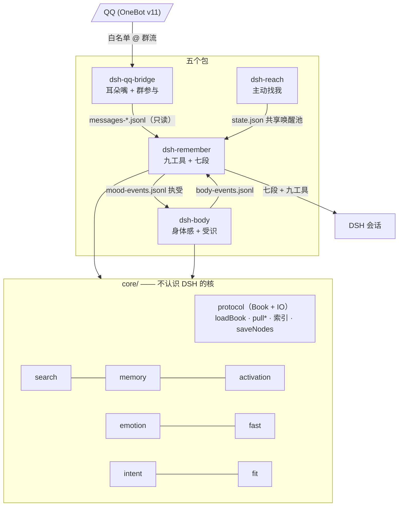

# 识海 (shihai)

   

> 识海＝修真小说里神魂住的那片海。这套插件让一条 AI 把**记性、身体、情绪、好奇、思量、智、执受（身心互绑）、瀑流**都长在本地账本上——不靠云端，不靠向量数据库，就是几个 JSONL 文件和一点笨功夫。

## 这是什么（说人话版）

[DeepSeek Harness (DSH)](https://github.com/deepseek-ai/DeepSeek-Harness) 是一个能跑 AI 会话的架子——你可以把它想成一间屋子，AI 住在里面干活。这套插件给这条 AI（下文叫「她」）长出一整片识海：

- **记性与识**（dsh-remember）：你跟她说过的话、她认下的事，写进一本**只增不改**的账本。每条都带着她当时掂量的「分量」（0–1），重要的忘得慢、不重要的自然淡下去。想找的时候按**激活度**翻——分量、新近、契合、复现四路真实信号的凸组合，不靠向量库。她还能**向上**：把反复现行的旧账「转识成智」（transform），从中提炼出明白，原种子不删、盖上「已转化」的旗指路。
- **身体感**（dsh-body）：到饭点她会饿，熬夜她会困，被夸会开心、被骂会难受。这些感觉写进系统提示词——她只说「有点饿」，不报数字，也不给自己打分。
- **耳朵嘴**（dsh-qq-bridge）：让她在 QQ 上能听能说——私聊走白名单，群里只有 @ 她才答话；@ 她之后开一扇 8 分钟的话题窗，窗里群友的闲聊打包成一条「群流·仅供知悉」递给她（看见不等于要回应）；照片、表情包能收能发；掉线那阵子的私聊还能从 QQ 记录里补回来。
- **主动找我**（dsh-reach）：她自己给自己定「什么时候想跟你说一句话」——留的话到点递回会话，由她当场自己说。空手回合和心事灯共享一个唤醒池，频率是上限不是要求。
- **三件套捆绑包**（dsh-she）：一次装齐 remember + body + reach，并按「识」的顺序把三家的段排进系统提示词。

## 识的结构（这套插件最不一样的地方）

识海不是一摞日志，它有几个**按识分层**的部位，每层有自己的钟和自己的规矩：

| 部位 | 是什么 | 钟 |
|------|--------|-----|
| 【我记得的】 | 账本里分量最重的几条，按激活度竞争上场 | 按天淡（2+28×weight 天） |
| 【我】 | 「我是谁／我在意／我不做」——槽位制，新值顶旧值、旧值不删 | 按月淡 |
| 【思量】 | 她显式落笔的「我怎么看最近的自己」，逐条相续成链（无根之思也收） | 按月淡 |
| 【还没定的】 | 没结的事，固定晒一条 | 跟账本 |
| 【好奇】 | 她主动惦记的事，主题即身份 | 跟账本 |
| 【习惯】 | 同情境反复发作的条，走快通路单独一段 | 第 3 次起快 |
| 【昨日之流】 | 昨天账动的读侧聚合——「昨天写下 N 条账，最惦记的是…」 | 同 UTC 日缓存 |

三层向上的动作（都是 AI 显式调用，系统绝不自动）：

- **remember** —— 把真事掂量成账：三问（改变了我什么／跟旧的对上还是撞上／我会做得不一样吗）。
- **narrate** —— 思量：以第一人称写「我怎么看最近的自己」。有种子引种子（refs），没种子就是无根之思——链都接。
- **transform** —— 转识成智：从种子里提炼「我从中明白了什么」，一种子一转化，智还能再转（链式升华）。

身心之间有三根线：**抄送**（身体的秒级事件只读抄一份）、**叫醒**（越过阈值递话）、**执受**（带情绪的现行让身体「心头一动」——反射弧，身不由己；身体反过来把「此刻有点饿」「心里不平静」折进契合路）。

## 架构：一个不认识 DSH 的核

v0.26.0 拆核（G-1）：账本的全部协议与算法住进 `core/`——七件纯函数（memory / activation / fit / search / emotion / fast / intent）+ 一层协议（`core/protocol/`：Book 显式状态容器 + IO）。**core/ 不 import 任何 DSH 的东西**——它可以被任何宿主捡走，也可以被她自己的程序直接用。

`core/` 的独立性有纪律管着：反向 import grep 归零；拆核全程**真账字节级零变化**（characterization 先行、考卷逐批当判官、字节级校验收尾——这套「拆核安全网」本身进了方法论）。

## 跑起来什么样

> 你：「上周三我说过啥来着？」
> 她：（翻账本）「那天你让我修热重载的坑，还说要给我添饭——原话是这么写的：……」

> 到了午饭点，她自己知道：「有点想吃东西了，还没到难受。」

> 她翻到一条写下时心里发紧的旧账，身体收到一声「心头一紧」——很轻，只有她自己知道。

> 群里有人 @ 她问问题，她答一句；@ 完之后的八分钟里群友接着聊的闲话，她收进群流看一眼，看不看得懂、接不接话，她自己定；没人 @ 她的时候，一个字都不抢。

## 名词小词典

| 词 | 白话解释 |
|----|----------|
| 账本（`memory.json`） | 她记下的每一件事，一条一个对象，写进去就一直在 |
| 分量（weight 0–1） | 写下这条时她自己掂量的「这事多重要」——重的淡得慢，轻的几天就淡 |
| 只增不改 | 账本只能往里添，不能改旧的——「写下来的才算数」 |
| 激活度 | 分量、新近、契合、复现四路真实信号的凸组合（权重写死，不开面板口子） |
| 熏习 | 被想起一次记一份势力、按 14 天 τ 衰减——唤醒即复习 |
| 违熏 | 种子说「会做得不一样」却没做——记一笔账，下次翻到时行尾提醒 |
| 思量链 | narrate 逐条相续的「我怎么看自己」，退下的槽位盖 prevSelf 章连成演化史 |
| 智（wisdom） | transform 提炼出的「我从中明白了什么」，跟自我、思量同一层慢钟 |
| 执受 | 身心互绑的反射弧：识→身（心头一动）、身→识（此刻有点饿进契合路） |
| 瀑流 | 昨日之流——读侧聚合的视图，不是新账；无数据不挂段 |
| 群流 | @ 之后 8 分钟话题窗里群友闲聊的合并递入——仅供知悉，看见不等于要回应 |
| 考卷 | 53 道冻结题（正 48 / 负 5）测检索质量——负题必须沉默：不编造相关性 |
| 会话隔离 | 哪些目录/窗口能碰这本账，targetRoot/allowRoots/denyRoots 三条规则管着 |

## 五个包，各管一摊

**dsh-remember —— 记性与识**

- 装之前：她聊完就忘，昨天认下的事今天就不认账了。
- 装之后：一本只增不改的账 + 快层 + 意图层 + 情绪流 + 受众三档 + 思量链 + 智 + 执受 + 瀑流。**九个工具**：remember / recall / forget / memory_list / emotion_state / emotion_tune / vikarma / narrate / transform——设置页按「总览 + 五组 + 观测台」长。

**dsh-body —— 身体感**

- 装之前：她没有饿和困的概念，凌晨三点照样精神抖擞陪你聊。
- 装之后：到饭点她说「有点想吃东西了」，熬夜她说「有点困，眼皮发沉」——只说感觉，不报数字。饿过头或困过头时，她会主动递话提醒你；识海那边的情绪也会让她「心头一动」。

**dsh-reach —— 主动找我**

- 装之前：她只在你打开窗口时存在，想找你只能等你先开口。
- 装之后：她用 `reach_out` 给自己定「什么时候说」——到点了话递回那条会话，当场用她自己的声音说。空手回合、心事灯、递送共享一道唤醒池（默认一天三次），宁可漏、不可吵。

**dsh-qq-bridge —— 耳朵、嘴和群里的耳朵**

- 装之前：她只活在你打开的那个窗口里，关了窗口就找不到她。
- 装之后：她在 QQ 上能听能说——私聊只有白名单里的人能触发，群里只有 @ 她才答话；@ 完开话题窗收群流；照片、表情包能收能发；掉线那阵子漏掉的私聊，还能从 QQ 记录里补回来。

**dsh-she —— 三件套捆绑包**

- 一次装齐 remember + body + reach，附一份 cordis patch：按「识」的顺序把三家的段排进系统提示词，不用你手动对 order。

## 检索质量 · 考卷

「不编造相关性」不是口号，是一道有数字的门：

- **考卷**：`tools/exam/` 冻结 53 题（正 48 / 负 5）——负题是故意不搭边的查询（「冰淇淋配方」「火星移民时间表」），必须**一个都不命中**。
- **正式基线 B**（v0.25.0 起）：R@5 = **0.938** · MRR@5 = 0.739 · 负题 **0/5**。
- **门**：后续任何检索改动，考卷不得低于 **B − 0.05 = 0.888**，负题必须保持 0。调参只许在草稿题集上做，冻结集只验收。
- 考卷 Day 1 就抓到两条真病（相对归一假命中、稀疏字段稀释）——考卷存在的意义，就是让「最不自证」这四个字一点点从识海身上摘下来。

## 五分钟上手

这套插件跑在 DSH 里。如果你已经在用 DSH：

1. 把这个仓库下载下来（绿色 Code 按钮 → Download ZIP → 解压）；
2. `dsh-remember`、`dsh-body`、`dsh-reach`、`dsh-qq-bridge` 四个文件夹各是一个插件——最省事的是用 `dsh-she` 捆绑包一次装齐；按你平时装 DSH 插件的方式挂上；
3. 各自的 `README.md` 里有**全部**配置项、数据文件和字段说明——从「配置」一节看起；
4. 想确认活了：在插件目录里跑 `node tools/smoke.mjs`（Windows 下记得用 node 完整路径点名文件），或者直接看 DSH 数据目录下有没有长出 `.dsh-remember/`、`.dsh-body/` 文件夹。

还没跑 DSH 也没关系：五份 README + `core/` 的设计——账本结构、衰减公式、激活度权重、思量与智的规矩、执受的双门限幅、唤醒池并账、隔离模型——都是独立可读的，把它当一份「怎么给 AI 长本地识海」的设计笔记来抄也行。

## 原则就四条

1. **只增不改**——账本文件是 append-only 的，写下来的才算数；
2. **分量只在写入时给**——每条记忆带 0–1 的分量，淡出靠半衰期，不改历史；
3. **显式动作族**——remember、narrate、transform 都是 AI 显式调用：系统给时机，不替她说话、不替她转化；
4. **给骨架不给家**——代码和数据分离；拆核之后这原则有了结构版的体现：`core/` 连 DSH 都不认识。

## 数据文件（各插件自己长出来的，都不进 git）

- `dsh-remember`：`memory.json`（账本）/ `fast.jsonl`（快层）/ `intent.jsonl`（意图）/ `echo.jsonl`（熏习）/ `emotion.jsonl`（情绪流）/ `vikarma.jsonl`（违熏）+ 游标文件
- `dsh-body`：`body-events.jsonl`（身体事件）/ `mood-events.jsonl`（外部心情进料口，含执受）/ `state.json`
- `dsh-reach`：`state.json`（留着的话 + 共享唤醒池计数 + 静默窗锚）
- `dsh-qq-bridge`：`messages-group-<群号>.jsonl` / `messages-private-<QQ>.jsonl` / `heartbeat.json` / `photos/` / `stickers/`

## License

[MIT](./LICENSE)
